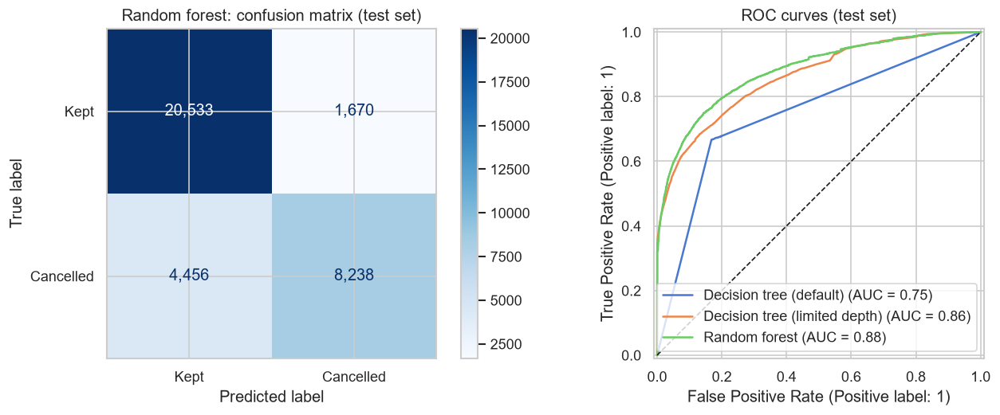
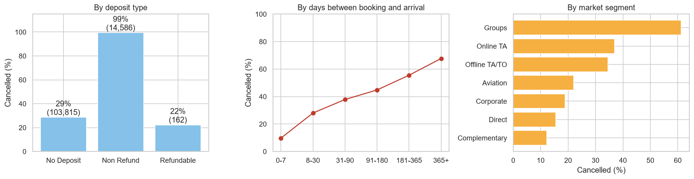
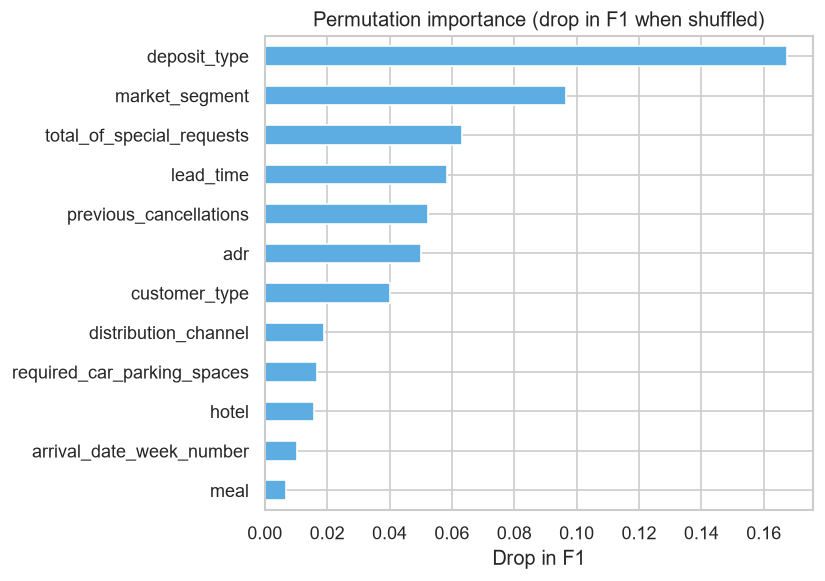

# Hotel booking cancellation prediction

[](https://github.com/muntaka123/hotel-cancellation-prediction/actions/workflows/notebook.yml)

Predicting whether a hotel booking will be cancelled, using only what the hotel knows when the booking is made.

About a third of the bookings in this dataset are cancelled. A model that flags likely cancellations lets a hotel overbook more safely, follow up with guests, or ask for a deposit.

**[Open the notebook](hotel_cancellations.ipynb)** to see the full analysis with code and charts.

> **About this version.** This started as coursework for the AI module in my final year at the University of Huddersfield (November 2024). In November 2026 I rewrote it as a standalone project: the same questions and data, explained in my own words, with the weak spots of the original fixed. They're listed under "What changed from the original" below.

## Results

Random forest on a held-out 30% test set (34,897 bookings):

| Model | Accuracy | Precision | Recall | F1 | ROC AUC |
|---|---|---|---|---|---|
| Always guess "not cancelled" | 0.636 | | | | |
| Decision tree (default) | 0.768 | 0.687 | 0.669 | 0.677 | 0.749 |
| Decision tree (depth 12) | 0.812 | 0.824 | 0.615 | 0.704 | 0.861 |
| **Random forest** | **0.824** | **0.831** | 0.649 | **0.729** | **0.881** |

5-fold cross-validation on the training set gives a similar F1 (0.745 ± 0.009).



## What drives cancellations



- **Non-refundable bookings are almost all cancelled (99%)**, the opposite of what you'd expect. It's probably down to how certain bookings, such as tour operator blocks, are labelled, and it's the model's strongest signal. So it's worth checking with the hotel before using the model for real decisions.
- **Booking further ahead means more cancellations:** about 10% for bookings made within a week of arrival, rising to over 50% for bookings made six months or more ahead.
- **Group and online travel agent bookings cancel most;** direct and corporate bookings least.
- The city hotel cancels more than the resort hotel (42% vs 28%), and returning guests cancel far less than new ones (16% vs 38%).



## Method

1. **Cleaning:** filled missing children (0) and country ("Unknown"), and removed bookings with no guests or no nights, plus two impossible prices.
2. **Exploring:** the cancellation rate by hotel, meal plan, returning guests, room type, deposit, lead time and market segment.
3. **Choosing features:** left out anything the hotel only learns later, such as the reservation status, the room assigned at check-in, booking changes and waiting list days. Also left out country, which may only be confirmed at check-in, and the arrival year, which won't apply to future bookings.
4. **Splitting without leakage:** about 40,000 rows are identical copies of another row, mostly group bookings. Identical rows always go to the same side of the 70/30 split, so the model is never tested on a copy of a booking it trained on.
5. **Modelling:** decision trees and a random forest in a scikit-learn `Pipeline`, compared with accuracy, precision, recall, F1 and ROC AUC, plus grouped cross-validation and permutation importance.

## What changed from the original

| Original (2024) | This version (2026) | Why |
|---|---|---|
| Kept the assigned room type, country, booking changes and arrival year | Left out | They're only known later or won't generalise, so they inflate the score |
| Random 70/30 split | Identical rows kept on the same side of the split | A random split puts copies of the same booking in both sets. On the same random forest it inflates accuracy from 0.824 to 0.857 |
| Scaled and encoded the whole dataset before splitting | Encoding inside a `Pipeline` fitted on training data only; no scaling | Avoids information from the test set leaking in; trees don't need scaling |
| Counted bookings with no nights but kept them | Removed | They can't be real stays |
| One default decision tree, accuracy only (84.5%) | Two trees and a random forest; five metrics; cross-validation | Accuracy alone flatters a model when most bookings aren't cancelled |
| Built-in tree importances | Permutation importance | Built-in importances favour features with many distinct values |

## Run it locally

You need Python 3.11 or newer.

```bash
python -m venv .venv
.venv\Scripts\activate          # Windows (on macOS/Linux: source .venv/bin/activate)
pip install -r requirements.txt
jupyter notebook hotel_cancellations.ipynb
```

The notebook's cells are generated from `build_notebook.py`, which is easier to review in a diff. After changing it, rebuild and re-run:

```bash
python build_notebook.py
jupyter nbconvert --to notebook --execute --inplace hotel_cancellations.ipynb
```

## Data and licences

`data/hotel_bookings.csv` is the *Hotel booking demand* dataset: 119,390 bookings from a city hotel and a resort hotel in Portugal, July 2015 to August 2017.

> Nuno Antonio, Ana de Almeida and Luis Nunes (2019). Hotel booking demand datasets. *Data in Brief*, 22, 41–49. [doi:10.1016/j.dib.2018.11.022](https://doi.org/10.1016/j.dib.2018.11.022)

The data belongs to its authors; see the article for its terms. The code in this repository is MIT licensed.

## Author

**Muntaka Mahdin** · [GitHub](https://github.com/muntaka123) · [LinkedIn](https://www.linkedin.com/in/muntaka-mahdin-2a80b8233/)

More of my projects: [Crime Lens](https://github.com/muntaka123/crime-lens) · [Pet Activity Tracker](https://github.com/muntaka123/pet-activity-tracker) · [Card-G](https://github.com/muntaka123/card-g) · [Hand-washing step recognition](https://github.com/muntaka123/hand-washing-steps)
